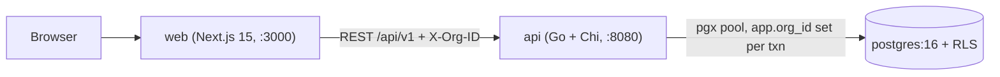
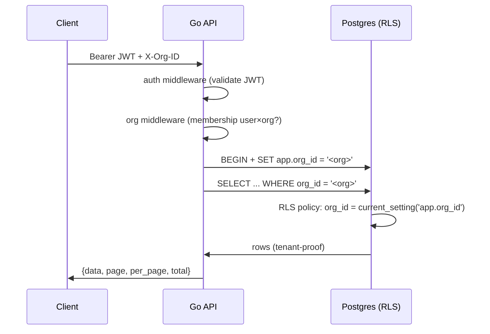

# Nexo CRM — Architecture

Multi-tenant CRM SaaS MVP. Monorepo: `backend/` (Go API), `frontend/`
(Next.js), `migrations/` (Postgres SQL), `docs/`.

## Components

- `api` auto-applies versioned migrations from `migrations/` on boot and
  seeds the demo org (`003_seed_demo.sql`).
- `openapi.yaml` is the contract; the API also serves it at
  `GET /openapi.yaml`.

## Request path & tenancy

Defense in depth, three layers:

1. **Middleware** — `X-Org-ID` must belong to the caller's memberships
   (`rbac.ResolveOrg`); otherwise `ErrNoAccess` before any SQL runs.
2. **App filter** — every query carries an explicit `org_id` predicate.
3. **RLS policies** (`002_rls.sql`) — `USING (org_id =
   current_setting('app.org_id')::uuid)` on every tenant table, so a
   missing filter fails closed instead of leaking.

## Auth

- JWT access token (Bearer, 15 min) + opaque rotating refresh token in an
  `httpOnly` cookie (7 days).
- `POST /auth/register|login|refresh|forgot|reset`; `forgot` always
  returns 200 (anti-enumeration), reset token goes to structured logs.
- Roles: `owner / admin / member / viewer` — read vs write vs
  settings/audit/delete gates in `internal/rbac`.

## API

- Base `http://localhost:8080/api/v1`, contract in `/openapi.yaml`.
- Resources: contacts (`q/page/per_page/status`), deals (+ audited stage
  move), tasks, interactions (contact/deal timeline), dashboard/summary,
  audit-logs, settings (JSONB merge).
- Money in cents (`value_cents`); dates `YYYY-MM-DD`.

## Data

- Postgres 16 via docker-compose (`api`, `web`, `postgres`).
- `001_init.sql` schema → `002_rls.sql` policies →
  `003_seed_demo.sql` fictitious seed (1 org, 20 contacts, 15 deals) →
  `004_interactions_cascade.sql`.
